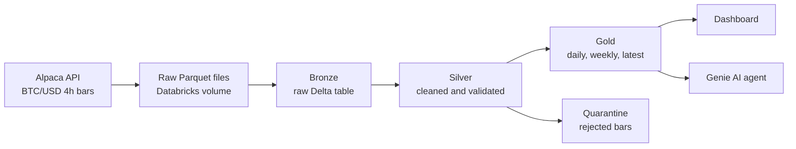
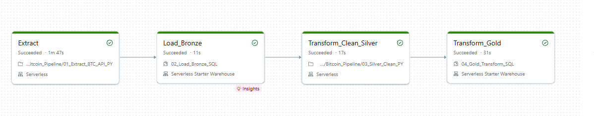
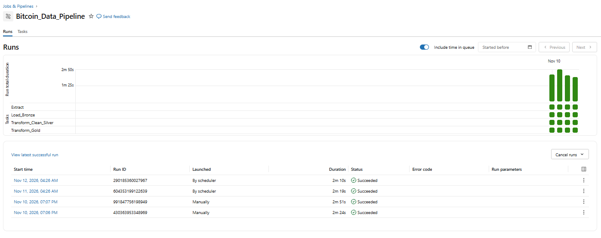
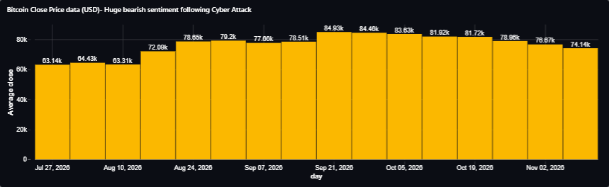
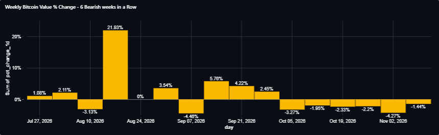
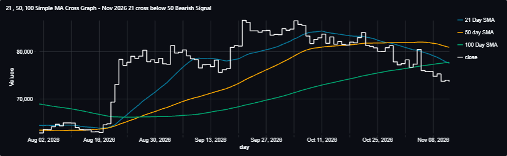
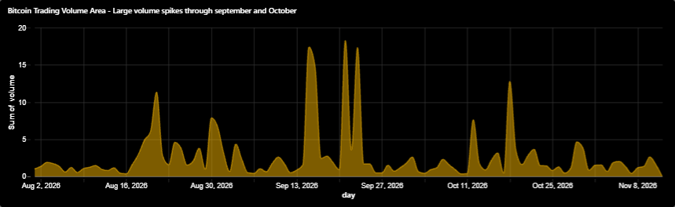
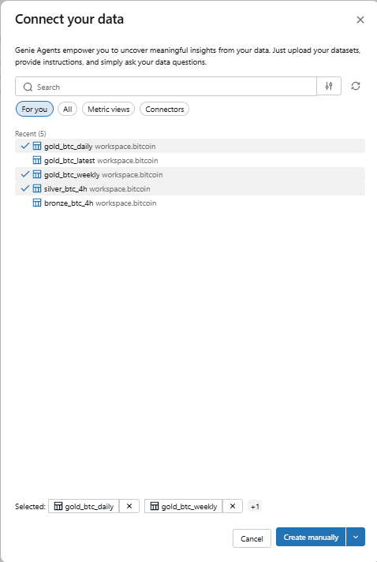
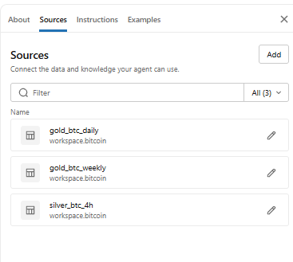
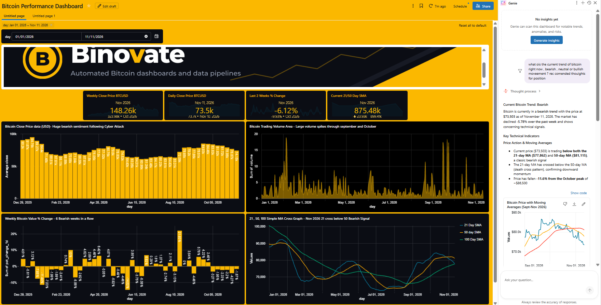

# Bitcoin (BTC/USD) Databricks ELT Pipeline

An automated ELT pipeline and dashboard for Bitcoin (BTC/USD), built on Databricks. It pulls 4-hour price bars from the Alpaca API, cleans and validates them, builds analysis-ready tables, and refreshes a dashboard every day with no manual work.

Binovate is a fictional trading firm used for this portfolio project. The aim is a low-cost, hands-off alternative to manual price tracking and spreadsheet admin.

## What it does

- Pulls BTC/USD 4-hour bars from Alpaca and lands them as monthly Parquet files
- Loads them untouched into a Bronze table, then cleans and validates them into Silver
- Builds daily, weekly and latest-price Gold tables for reporting
- Runs the whole chain on a daily Databricks schedule
- Feeds a Databricks dashboard and a Genie AI agent

## Architecture



The pipeline follows the medallion pattern (Bronze, Silver, Gold). It is ELT: raw data is loaded first, then every transform runs inside Databricks on serverless compute.



## Pipeline steps

Four chained tasks run in order as one Databricks job. A full run completes in roughly 2 minutes 46 seconds.

| Step | Task | File | Run time | What it does |
|---|---|---|---|---|
| 1 | Extract | [01_Extract_BTC_API_PY.ipynb](Python%20files/01_Extract_BTC_API_PY.ipynb) | 1m 47s | Pulls bars from Alpaca from the first day of the previous month, writes one Parquet file per month plus a manifest |
| 2 | Load_Bronze | [02_Load_Bronze_SQL.sql](SQL%20Files/02_Load_Bronze_SQL.sql) | 11s | Rebuilds `bronze_btc_4h` from the raw files, adding load time and source file name |
| 3 | Transform_Clean_Silver | [03_Silver_Clean_PY.ipynb](Python%20files/03_Silver_Clean_PY.ipynb) | 17s | Removes duplicates, fixes types, runs validation checks, quarantines bad bars |
| 4 | Transform_Gold | [04_Gold_Transform_SQL.sql](SQL%20Files/04_Gold_Transform_SQL.sql) | 31s | Builds the daily, weekly and latest tables |

Each daily run re-pulls the previous and current month, so the pipeline can safely see the same bar twice. Silver keeps the copy from the latest load.



## Data quality

Silver checks every bar and moves failures to a quarantine table instead of deleting them. Each issue is written to a log table.

From the latest Silver run: **8,825** bronze rows in, **8,822** clean rows out, **3** bars quarantined, **0** gaps in the 4-hour series.

Every bar is checked for:

- Null timestamp, price or volume
- Price zero or negative
- High below the open, close or low
- Low above the open, close or high
- Negative volume
- Timestamp off the 4-hour grid
- Zero volume or zero trades
- Breaks in the 4-hour sequence

Run summaries go to a `pipeline_runs` table.

## Data model

All tables are in the `workspace.bitcoin` schema.

| Table | Layer | One row per |
|---|---|---|
| `bronze_btc_4h` | Bronze | Raw 4-hour bar as loaded |
| `silver_btc_4h` | Silver | Validated UTC 4-hour bar |
| `silver_btc_4h_quarantine` | Silver | Rejected bar |
| `gold_btc_daily` | Gold | UTC day |
| `gold_btc_weekly` | Gold | UTC week, Monday to Sunday |
| `gold_btc_latest` | Gold | Single row feeding the dashboard tiles |

Days and weeks still in progress are kept but flagged `is_incomplete`, so charts can exclude them while the latest price can still use them. All times are UTC.

## What the data shows

A read of the Gold tables over August to November 2026:

- Bitcoin climbed from roughly **$63k** in late July to a peak weekly close near **$84.9k** in the week of 21 September, then sold off to a latest daily close of **$73.67k** on 12 November, down **5.9%** over the last two weeks.
- The 21-day simple moving average crossed **below** the 50-day in November, a bearish signal.
- Weekly change ran negative for **six weeks in a row** after a run of green weeks over the summer.
- Trading volume spiked through September and October as the move accelerated.

| Close price | Weekly % change |
|---|---|
|  |  |
| **Moving averages** | **Trading volume** |
|  |  |

## Dashboard

The Bitcoin Performance Dashboard sits on the Gold tables and is styled in the Binovate brand. It shows how the price is changing rather than just where it is: tiles for the current price and the price a week ago, plus daily and weekly rate of change. A PDF export is in [Project Slides & Dashboard](Project%20Slides%20%26%20Dashboard).

## AI agent

A custom Databricks Genie agent is connected to the Silver and Gold tables, so questions about Bitcoin can be answered in plain English. Its instructions are in [bitcoin_agent.md](SQL%20Files/bitcoin_agent.md).

**Data sources:** `silver_btc_4h`, `gold_btc_daily` and `gold_btc_weekly` in `workspace.bitcoin`.

**How it behaves:**

- Picks one table that matches the question (the three views are never joined)
- Reports percentage changes as stored, in percentage points, and volume in BTC rather than US dollars
- Excludes incomplete days and weeks for historical statistics, but uses the newest row for the current price
- Reads "today" and "this week" in UTC
- Describes technical sentiment as bullish, bearish or neutral for the timeframe asked, and makes clear it is a reading of history, not financial advice or a prediction






## Tech stack

- Databricks Free Edition (notebooks, SQL, jobs, dashboards, Genie)
- Python (pandas, alpaca-py) and SQL
- Delta tables, Parquet files in a Databricks volume
- Alpaca crypto market data API

## Repository structure

```
.
├── Python files/              Extract and Silver notebooks
├── SQL Files/                 Bronze and Gold SQL, plus the agent instructions
├── images/                    Screenshots and brand assets
├── Project Slides & Dashboard/  Slide deck and dashboard PDF exports
└── README.md
```

## How to run

1. Create the `workspace.bitcoin` schema and a `raw` volume in Databricks.
2. Run `01_Extract_BTC_API_PY` to pull Alpaca bars into the volume (needs Alpaca API keys).
3. Run `02_Load_Bronze_SQL`, then `03_Silver_Clean_PY`, then `04_Gold_Transform_SQL`.
4. Chain the four as a Databricks job and set a daily schedule.
5. Point the dashboard and the Genie agent at the Gold and Silver tables.

## Disclaimer

Educational portfolio project. Nothing here is financial advice.
